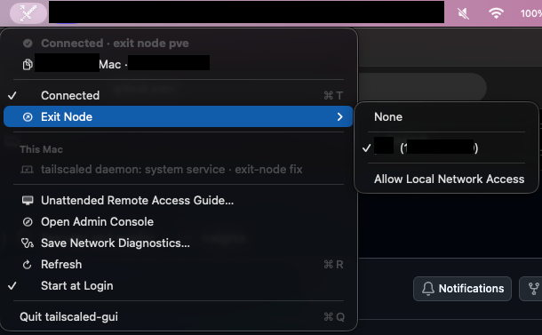

# tailscaled-gui


Control Tailscale and set up your MacBook for unattended remote access, even with the lid closed and after restarts.

**Tested with:** Tailscale / `tailscaled` **1.104.1**, with the included **exitfix v4** patch, on **macOS 26.2 on Apple silicon**. Other versions and platforms have not been verified. Exit-node switching requires the patched daemon.

> Unofficial project. Not affiliated with or endorsed by Tailscale Inc.




## Why tailscaled-gui?

The official Tailscale macOS apps don't run before a user logs in. The App Store app is sandboxed, while the standalone app uses a sandboxed system extension; their pre-login limitation is shared, not the same sandbox arrangement. The open-source `tailscaled` variant can run as a system service before login once the startup disk is unlocked, but it has no official GUI. tailscaled-gui provides a menu for that variant after you sign in. See [Tailscale's macOS comparison](https://tailscale.com/docs/concepts/macos-variants).

Tailscale describes standalone daemon operation on macOS as [unsupported](https://tailscale.com/docs/how-to/run-unattended) and recommends the open-source variant only for experienced administrators.

## Unattended remote access

Use **Unattended Remote Access Guide…** in the menu to check your setup and walk through the steps. It covers connecting with Tailscale, controlling the Mac with RustDesk, keeping it awake with optional [Caffeine](https://github.com/bestutsengineer/caffeine), and testing after a restart. Optional sections explain security and technical details.

After a normal restart, **FileVault may require someone at the Mac to unlock the disk** before remote services can start. Turning FileVault off can remove that step, but makes files easier to access if the Mac is lost or stolen. The guide explains the choice; it does not change FileVault or install other apps for you.

Closed-lid access depends on a suitable power, display or sleep-prevention setup. Keep the Mac powered, awake and online, then test from another device with the lid closed and after a restart **before relying on unattended access**. The guide's checks cannot guarantee that a remote connection will work.

## What the icons mean

| Menu bar icon | Meaning |
| --- | --- |
|  | Connected |
|  | Connected through an exit node |
|  | Disconnected |

## Using the menu

- **Single-click** the icon to open the menu; right-click opens it immediately.
- **Double-click** to connect without an exit node, or to disconnect.
- **Triple-click** to connect using the last successfully used exit node. If none was saved, it connects without one.
- Choose **Exit Node** to select a node or **None**. Click your Tailscale IP to copy it.

If the remembered exit node is unavailable, the app reports an error and leaves the connection unchanged.

## Getting started

You need macOS 14 or later and Homebrew's Tailscale system daemon. The app is currently installed from source; open the installation steps in [For developers](#for-developers) below. Avoid running the official Tailscale app alongside this daemon; see [Tailscale's macOS variants](https://tailscale.com/kb/1065/macos-variants).

To uninstall, turn off **Start at Login** in the menu, quit the app, and remove `tailscaled-gui.app` from your Applications folder. The Tailscale daemon remains installed.

## For developers

<details>
<summary>Installation, implementation, testing and security details</summary>

### Installation from source

Install Apple's command-line tools and Homebrew, then:

```bash
brew install tailscale
sudo "$(brew --prefix)/bin/tailscaled" install-system-daemon
sudo tailscale up
sudo tailscale set --operator="$USER"
git clone https://github.com/bestutsengineer/tailscaled-gui-macos.git
cd tailscaled-gui-macos
./build.sh --install
open ~/Applications/tailscaled-gui.app
```

The operator setting lets programs running as your user change or disconnect Tailscale, without giving them root access. Without it, the app can show status but changes require additional privileges. Undo it with `sudo tailscale set --operator=`.

The app is built with `swiftc`, ad-hoc signed, and installed to `~/Applications`. **Start at Login** creates `~/Library/LaunchAgents/local.tailscaled-gui.agent.plist`. The daemon is a separate system service and starts after the startup disk is unlocked; its saved connected/disconnected preference persists across restarts.

When upgrading from Tailnet, the app reads its previous last-used exit node and migrates its login item. Its recovery directory retains the legacy name to preserve an in-flight rollback. Quit the old Tailnet app before starting the renamed app for the first time.

### Exit-node patch and rollback

Stock `tailscaled` 1.104.1 was observed failing to install an exit-node default route on macOS; clearing it could remove the physical default route. The [exitfix v4 patch](tailscaled-exitfix/README.md) uses split routes and protects physical, interface-scoped routes. Other upstream versions have not been verified. The app requires the v4 marker before enabling exit-node changes; clearing a selected node remains available.

The patch installer builds and runs a **root system daemon**, restarts it, and pins Homebrew's Tailscale package. Review the script first, keep a local recovery option, and use `tailscaled-exitfix/build.sh --no-install` to build without installing. See the [patch documentation](tailscaled-exitfix/README.md) for installation and undo instructions.

Before a change, an independent launchd watchdog records the previous settings and must acknowledge readiness. The app validates the requested state, online peer, IPv4 tunnel routes, and HTTPS/DNS probes that worked before the change. Failure triggers restoration; the worker retries after a timeout if needed. Clear remains available when internet is already down. Changes from another client during the rollback window can be overwritten.

If `~/Library/Application Support/Tailnet/exit-change/recovery.json` remains after all recovery attempts, inspect it and restore the saved settings with the Tailscale CLI before removing it. Removing it during an active transaction disables recovery.

### Command line and diagnostics

The binary is `~/Applications/tailscaled-gui.app/Contents/MacOS/tailscaled-gui`. It accepts `--status`, `--menu`, `--diagnose`, `--connect`, `--connect-last-exit`, `--disconnect`, `--exit-node NAME|IP|none`, `--lan on|off`, and `--login-item on|off`.

Exit-node transactions write private reports to `~/Library/Logs/tailscaled-gui/` (the 12 newest are retained). **Save Network Diagnostics…** gathers a read-only report and does not upload it. Reports can contain private IPs and network details; review them before sharing.

### Tests and contributions

Run `./Tests/run.sh` for mocked route, rollback, gesture, connection, guide and login-migration checks. These do not replace live network and restart tests. Regenerate the app, menu and README icons from `Sources/SwordIcon.swift` with `./tools/make-icon.sh`.

Install scanners with `brew install gitleaks trufflehog` and enable the staged hook with `git config core.hooksPath .githooks`. Before publishing, scan the working tree and all Git refs; do not ship builds, diagnostics, local notes, or private machine configuration. The environment examples are placeholders and the app does not load them.

</details>

## License

Original app code: [MIT](LICENSE). The Tailscale-derived patch retains its [BSD-3-Clause license](tailscaled-exitfix/LICENSE); see [third-party notices](NOTICE.md), especially before distributing daemon binaries.
